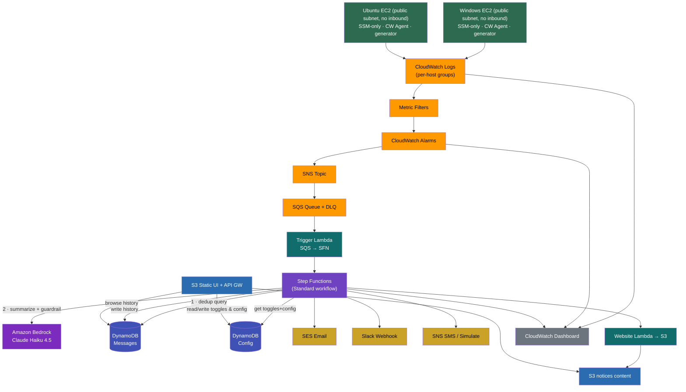
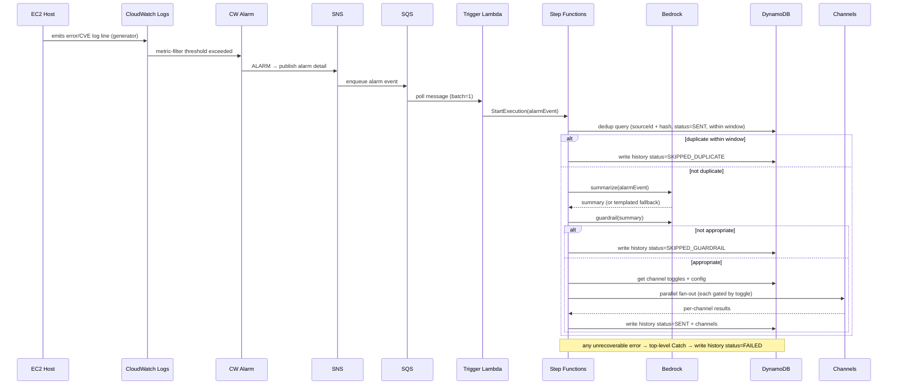

# Notification System — Design

## Overview

A single AWS account / single-region (`us-east-1`) system built with the AWS CDK
(TypeScript). Two EC2 hosts emit log lines that CloudWatch turns into alarms.
Alarms fan out via SNS into an SQS buffer; a thin Lambda starts a **Step
Functions Standard workflow** per message. The workflow uses **Amazon Bedrock**
to summarize and vet the message — after first checking a DynamoDB-backed
de-duplication window so duplicates never reach Bedrock — reads per-channel toggles + config from DynamoDB, and fans out in
parallel to the enabled channels: SES email, Slack webhook, SNS SMS (with a
simulate fallback), and a website update (S3 object write). An operator UI
(S3 static site + API Gateway HTTP API) toggles channels and edits channel
config — including the Slack webhook URL — and browses message history. A
CloudWatch dashboard ties detection and delivery together.

## Context

This is a demo / test system that proves out a "massive notification system for
a municipality via many mechanisms" pattern without standing up a real PHP
application or production SMS origination. The target AWS profile is
`roitraining` (account `<account-id>`), region `us-east-1`. SES starts in
sandbox mode (verified identities only). Bedrock model access is already
available in the account (Claude Haiku 4.5 verified invocable 2026-11-17); the
system still degrades gracefully if Bedrock becomes unavailable.

## Goals

- End-to-end, observable flow from a host log line to one or more user-visible
  notifications.
- Every workflow run visible and inspectable in the Step Functions console.
- Channels independently togglable and configurable at runtime, no redeploy.
- AI-assisted summarization with an appropriateness guardrail and anti-spam
  de-duplication.
- Cheap to run and trivially tear down.

## Non-goals

- Production SMS carrier approval; production email domain verification.
- A real PHP application (a synthetic generator stands in).
- High-throughput tuning (single-digit messages per minute is the expected load).
- Multi-account or cross-region fan-out.

## Architecture



## Data Flow



## Components & Responsibilities

| Component | Responsibility |
|---|---|
| EC2 (Win + Ubuntu) | Run the synthetic error generator in bursts; ship logs via CloudWatch Agent; SSM-only access; public subnet, public IP, zero inbound rules. |
| CloudWatch Logs + Metric Filters | Ingest logs; create metrics from error/CVE patterns. |
| CloudWatch Alarms | Threshold on metric-filter metrics; `treatMissingData: notBreaching` so they return to OK between bursts; ALARM state publishes to SNS. |
| SNS Topic | Alarm target; fans alarm events to the SQS subscription. |
| SQS Queue + DLQ | Durable buffer ("place to put the messages"); DLQ captures poison messages. |
| Trigger Lambda | Polls SQS (batch 1), parses the SNS/alarm payload, calls `StartExecution`. |
| Step Functions (Standard) | Orchestrates dedup → summarize → guardrail → fan-out → history, with a top-level Catch that records FAILED; visible per execution. |
| Summarize Lambda | Calls Bedrock (Claude Haiku 4.5, Converse API) for a concise summary; templated fallback on failure. |
| Guardrail Lambda | Classifies the summary as appropriate or not; reason returned. |
| Dedup Lambda | Runs first. Queries recent `SENT` messages for the source + dedup hash within the window; returns duplicate flag. |
| Config Lambda | Returns toggles + channel config (incl. Slack webhook) from DynamoDB. |
| Email (SES) | Native Step Functions SES integration; sends summary to verified recipient. |
| Slack Lambda | POSTs the summary to the configured incoming webhook. |
| SMS Lambda | Publishes via SNS SMS; logs a simulated send when not permitted. |
| Website Lambda | Writes `notices/latest.json` and updates `notices/history.json` using S3 conditional writes (If-Match + retry) to avoid lost updates from parallel executions. |
| WriteHistory Lambda | Writes the history record (status, per-channel results, summary) and emits per-channel delivery metrics via CloudWatch Embedded Metric Format. |
| DynamoDB `Notifications` | Message/history store; sourceId+createdAt key; GSI for recency; TTL. |
| DynamoDB `Config` | Per-channel enabled flag + config (Slack webhook, emails, simulate flag); global settings. |
| Operator UI (S3 static) | Toggles, channel-config editor (incl. Slack webhook), history browser. |
| API Gateway HTTP API | REST endpoints for config GET/PUT and history GET, fronting a Lambda. |
| Config/History Lambda | Implements the API: checks the operator key, validates and merges config edits, queries the history GSI. |
| Operator key (Secrets Manager) | Generated secret; the UI sends it as `x-operator-key`. |
| CloudWatch Dashboard | EC2 metrics, metric-filter counts, alarm states, per-channel delivery counts/errors. |

## Interfaces

### SQS message → Trigger Lambda

The queue is subscribed to the SNS topic, so each message body is an SNS
notification wrapper. The trigger Lambda parses `JSON.parse(body).Message`, the
CloudWatch alarm JSON, and builds the Step Functions input:

```jsonc
{
  "alarmName": "high-cve-rate-win",
  "state": "ALARM",
  "stateChangeTime": "2026-11-17T20:00:00.000Z",
  "reason": "Threshold Crossed...",
  "trigger": {
    "metricName": "CveHits",
    "namespace": "App/Notifications",
    "dimensions": { "host": "win-01" }
  },
  "sourceId": "host:win-01",
  "eventType": "CveHits",
  "severity": "HIGH",
  "receivedAt": 1731867600000,
  "rawEvent": "{...original alarm JSON...}"
}
```

### Step Functions task contracts

| Task | Input | Output |
|---|---|---|
| Dedup (first) | `{ sourceId, eventType, severity }` | `{ duplicate: bool, dedupHash, lastSentAt? }` |
| Summarize | `{ rawEvent, eventType, severity, alarmName }` | `{ summary }` (Bedrock) or `{ summary, fallback: true }` |
| Guardrail | `{ summary, fallback }` | `{ appropriate: bool, reason }` |
| GetConfig | `{}` | `{ email:{enabled,config}, slack:{enabled,config}, sms:{enabled,config}, website:{enabled,config} }` |
| Email (native `sesv2:SendEmail`) | `{ summary, alarmName, config.email }` | `{ channel, status, messageId? }` |
| Slack | `{ summary, alarmName, config.slack }` | `{ status }` |
| SMS | `{ summary, alarmName, config.sms }` | `{ status, simulated: bool }` |
| Website | `{ summary, alarmName, config.website }` | `{ status, uri }` |
| WriteHistory (Lambda) | `{ ...input, status, channels[], error? }` | `{ recorded: true, messageId }` |

Every channel task returns `{ channel, status, ... }`; disabled channels
return `DISABLED`, caught failures return `FAILED` with the error cause.

`dedupHash = sha256(sourceId + ":" + eventType + ":" + severity)` (first 16 hex chars).

### Operator API (API Gateway HTTP API)

| Method | Path | Body / Query | Returns |
|---|---|---|---|
| GET | `/channels` | — | all channel toggles + config |
| PUT | `/channels/{name}` | `{ enabled?, config? }` | updated channel object |
| GET | `/history` | `?limit=50` | recent messages (status + channels + summary) |
| GET | `/health` | — | `{ ok: true }` |
| PUT | `/settings/dedup` | `{ windowMinutes }` | updated setting (1–1440) |

`{name}` ∈ `email | slack | sms | website`. PUT updates only supplied fields;
partial config edits (e.g. setting only `slack.config.webhookUrl`) merge.

**Auth:** every route except `/health` requires header `x-operator-key`
matching the generated Secrets Manager secret (constant-time compare), else 401.

**Validation:**
- `slack.config.webhookUrl` must start with `https://hooks.slack.com/`.
- `email.config.fromAddress` / `toAddresses` are read-only via the API (400).
- `sms.config.phoneNumber` must be E.164 (`+` and 8–15 digits) or empty.
- Unknown config keys are rejected.

## Data Models

### DynamoDB `Notifications`

| Attribute | Type | Key? | Notes |
|---|---|---|---|
| `sourceId` | String | PK | e.g. `host:win-01` |
| `createdAt` | Number | SK | epoch ms |
| `messageId` | String | | ULID |
| `dedupHash` | String | | sha256(sourceId+eventType+severity), 16 hex |
| `alarmName` | String | | source alarm |
| `aiFallback` | Boolean | | true when the templated summary was used |
| `error` | String | | populated when status = FAILED |
| `eventType` | String | | e.g. `CveHits`, `AuthFail`, `AppException` |
| `severity` | String | | `LOW`/`MEDIUM`/`HIGH` |
| `rawEvent` | String | | original alarm JSON |
| `summary` | String | | AI (or templated) summary |
| `status` | String | | `SENT`/`NOT_DELIVERED`/`SKIPPED_DUPLICATE`/`SKIPPED_GUARDRAIL`/`FAILED`. `SENT` requires ≥1 channel `SENT`/`SIMULATED`; otherwise `NOT_DELIVERED` (does not count for dedup). |
| `channels` | Map | | `{ email:{status}, slack:{status}, sms:{status, simulated}, website:{status} }` |
| `gsiPk` | String | GSI PK | constant `"RECENT"` for the recency index |
| `ttl` | Number | | epoch, ~90 days |

**GSI `RecentIndex`**: PK `gsiPk`, SK `createdAt` → gives a globally
time-ordered list for the history API (`ScanIndexForward=false`, `Limit=N`).

### DynamoDB `Config`

| PK | SK | Attributes |
|---|---|---|
| `channel` | `email` | `{ enabled: true, config: { fromAddress, toAddresses: ["<notifyEmail from local.config.json>"] } }` |
| `channel` | `slack` | `{ enabled: false, config: { webhookUrl: "https://hooks.slack.com/services/REPLACE_ME" } }` |
| `channel` | `sms` | `{ enabled: true, config: { simulate: true, phoneNumber: "" } }` |
| `channel` | `website` | `{ enabled: true, config: { bucket, key } }` |
| `settings` | `dedup` | `{ windowMinutes: 15 }` |

Seeded by CDK on deploy; the UI can edit any of these at runtime.

## AI / Bedrock Integration

- **Model:** Anthropic Claude Haiku 4.5 via the US cross-region inference
  profile `us.anthropic.claude-haiku-4-5-20251001-v1:0`, called with the
  Converse API. Verified invocable in the account on 2026-11-17 (Claude 3.5
  Haiku is not offered in the account; Haiku 5.5 is listed but returns
  AccessDenied). No console enablement step is needed. If Bedrock errors, the
  Summarize Lambda returns a templated summary (`fallback: true`) so the
  system runs end-to-end.
- **IAM:** an inference profile routes to several regions, so
  `bedrock:InvokeModel` is granted on the inference-profile ARN
  (`arn:aws:bedrock:us-east-1:<acct>:inference-profile/us.anthropic.claude-haiku-4-5-20251001-v1:0`)
  **and** the foundation-model ARN in every routed region
  (`arn:aws:bedrock:{us-east-1,us-east-2,us-west-2}::foundation-model/anthropic.claude-haiku-4-5-20251001-v1:0`).
  Granting only the model ARN would deny every call and silently force the fallback.
- **Summarize prompt:** system message fixes tone for a municipality public
  notice — plain language, states what happened, affected host, severity, and
  recommended action; constrained to ~2–3 sentences. The user message is the
  raw alarm event JSON.
- **Guardrail:** a deterministic rule pre-check (credentials/keys, SSNs, card
  numbers, profanity) runs first; if it passes, Bedrock classifies the summary
  and returns strict JSON `{ appropriate, reason }`. If Bedrock is unavailable
  (or the summary is already a fallback template) the rule result stands and the
  reason notes that AI review was skipped.
- **SMS/website wording:** the same concise summary is reused; SMS additionally
  truncates to a carrier-safe length with a link omitted by default.

## Error Handling

- **Top-level Catch:** the whole post-trigger flow runs inside a single-branch
  Parallel with a Catch; any unrecoverable error writes a `FAILED` history
  record (with the error cause) and then fails the execution, so every event
  leaves a trace in the history view.
- **SQS DLQ:** after the configured receive count (default 5), unprocessable
  events move to the DLQ; DLQ depth is a dashboard metric.
- **Step Functions retries:** each Lambda task uses `Retry` with `ErrorEquals`
  `Lambda.ServiceException`/`Lambda.TooManyRequests`/`States.TaskFailed`,
  `MaxAttempts: 3`, `BackoffRate: 2`. Channel failures are caught and recorded
  per channel; one channel failing does not fail the execution.
- **Bedrock unavailable:** summarization falls back to a template; flagged in
  history so the operator sees AI was not used.
- **Slack misconfigured:** missing/placeholder webhook → channel recorded as
  `SKIPPED_MISCONFIGURED`, not a workflow failure.
- **SMS not permitted:** recorded as `SIMULATED` with the would-be payload
  logged, so the demo still demonstrates the path.

## Detection Tuning

CloudWatch alarms notify only on state *transitions*. A generator emitting
continuously would hold an alarm in ALARM and produce exactly one notification.
So:

- The generator alternates a **burst** (one random event type, ~6 lines over
  ~1 minute) with a **quiet period** (default 5 minutes, INFO lines only).
- Alarms: period 60 s, 1 evaluation period, threshold ≥ 3, `treatMissingData:
  notBreaching` → OK again within a minute or two after each burst.
- With a 15-minute dedup window, repeated bursts of the same type from the same
  host demonstrate `SKIPPED_DUPLICATE` in history.

## Testing Strategy

- **CDK synth** (`npm run synth`) is the first gate: the app must synthesize
  with no errors.
- **Lambda unit tests** (Node test runner) for pure logic: alarm payload
  parsing, `dedupHash`, dedup window math, guardrail rule fallback, channel
  gating. External AWS calls are mocked.
- **Integration via deploy:** deploy, trigger the generator on both hosts,
  confirm a Step Functions execution appears per alarm, dedup suppresses a
  repeat, and toggling a channel off changes the next execution's fan-out.
- **Manual smoke** against the UI: flip channels, set the Slack webhook, view
  history.

## Technology Stack

- **IaC:** AWS CDK v2 (TypeScript), esbuild-bundled NodejsFunction (Node 24 runtime).
- **Compute:** Lambda (Node 24), Step Functions Standard; EC2 `t3.small`
  (Ubuntu 24.04) and `t3.medium` (Windows Server 2022).
- **AI:** Amazon Bedrock — Claude Haiku 4.5 (US inference profile).
- **Storage:** DynamoDB (2 tables, 1 GSI), S3 (UI + notices content).
- **Messaging:** SNS topic, SQS + DLQ, SES, SNS SMS.
- **Edge/API:** S3 static website hosting + API Gateway HTTP API v2; operator
  key in Secrets Manager.
- **Networking:** VPC with public subnets only (2 AZs). No NAT gateway and no
  interface VPC endpoints; hosts have public IPs but zero inbound rules.
- **Telemetry:** CloudWatch Logs, Alarms, Dashboard; metric filters.

## Non-functional Considerations

- **Security:** EC2 access is SSM Session Manager only — no key pair, no
  inbound rules. Lambda roles are least-privilege per function (e.g. the
  website Lambda can only write its bucket path; Slack Lambda has no AWS data
  permissions). The config API requires an operator key (shared secret); the
  Slack webhook is restricted to `hooks.slack.com` and email addresses are not
  editable via the API, so the API cannot redirect notifications to arbitrary
  destinations. Production would replace the shared key with Cognito/IAM auth.
- **Email deliverability:** SES sends *as* a `@gmail.com` address, which fails
  Gmail's DMARC alignment; expect messages in the spam folder. Production would
  use a verified domain with DKIM.
- **Cost:** no NAT gateway and no interface endpoints (≈$70/month saved);
  two public IPv4 addresses (≈$7/month); instances stop on demand; Bedrock calls
  are tiny; SES sandbox is free for verified addresses. Full teardown via `cdk destroy`; instances can be stopped
  separately to pause cost while keeping state.
- **Scalability:** designed for low volume. SQS buffering + Step Functions
  Standard handle spikes of dozens of messages; DynamoDB on-demand billing
  matches the bursty, low-volume profile.

## Requirements Coverage

| Requirements area | Primary components |
|---|---|
| Detection & Ingestion | EC2, CW Agent, Logs, Metric Filters, Alarms, SNS, SQS+DLQ |
| Orchestration | Trigger Lambda, Step Functions (retries + visible steps) |
| AI Summarization & Guardrail | Summarize Lambda + Bedrock (fallback), Guardrail Lambda |
| Anti-Spam / De-duplication | Dedup Lambda + `Notifications` table + `Config.settings/dedup` |
| Delivery Channels | SES, Slack Lambda, SMS Lambda (+simulate), Website Lambda + S3 |
| Configuration & Operator UI | `Config` table, Config/History Lambda, API GW, S3 static UI |
| Observability | CloudWatch Dashboard, metric filters, DLQ depth |
| Resilience, Safety & Cost Control | SSM-only EC2 (public subnet, no inbound, no NAT/endpoints), operator key, top-level FAILED catch, stop + destroy scripts |
